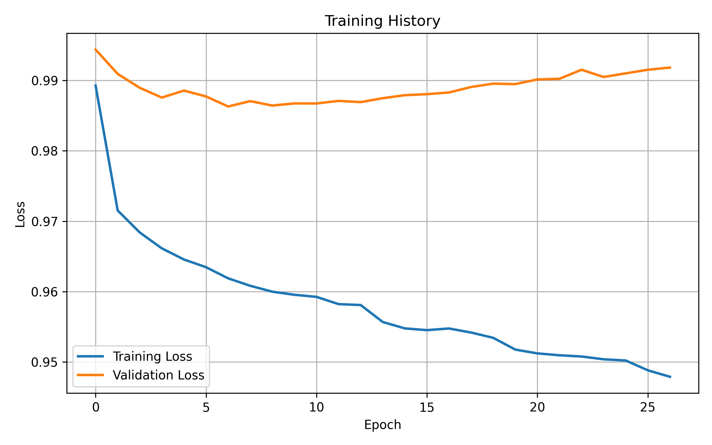
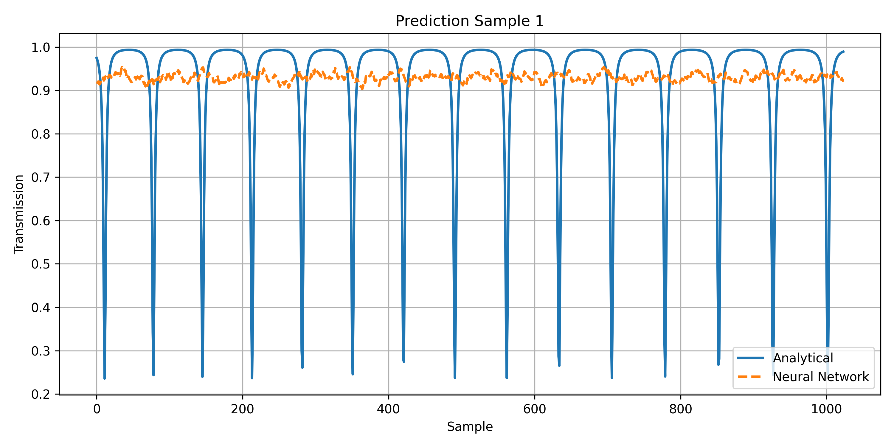

# Project 5 — Ring Resonator Design Platform

## Overview

This project is part of my Photonics Engineering Portfolio.

The goal was to build a complete machine learning assisted design platform for an all-pass silicon ring resonator. Instead of performing expensive analytical simulations every time, a neural network surrogate model was trained to predict the transmission spectrum directly from device parameters.

The project combines:

- Photonics
- Optical device modeling
- Numerical simulation
- Machine Learning
- Scientific Python
- Software Engineering

---

## Results

### Training Loss



### Example Prediction




# Objectives

The project aims to:

- Understand ring resonator physics
- Generate a large simulation dataset
- Train multiple surrogate models
- Compare machine learning approaches
- Build a reusable design workflow

---

# Device

The simulator models an all-pass silicon ring resonator.

Input parameters:

- Ring radius
- Effective refractive index
- Self-coupling coefficient
- Propagation loss

Output:

- 1024-point transmission spectrum

---

# Repository Structure

project-5-ring-resonator-design-platform/

├── data/
├── models/
├── notebooks/
├── results/
├── src/
│   ├── analytical_model/
│   ├── dataset_generation/
│   ├── machine_learning/
│   │   ├── random_forest/
│   │   ├── xgboost/
│   │   └── neural_network/
│   └── visualization/
├── README.md

---

# Physics

The analytical simulator computes the transmission spectrum using the classical all-pass ring resonator equation

T = ...

The generated spectra are used as ground truth for machine learning.

---

# Machine Learning Models

Three surrogate models were developed.

## Random Forest

- Fast training
- Strong baseline

## XGBoost

- Improved regression performance
- Better generalization

## Neural Network

Architecture:

4

↓

128

↓

256

↓

512

↓

1024

Activation:

- ReLU

Optimizer:

- AdamW

Normalization:

- StandardScaler (inputs)
- StandardScaler (outputs)

Training:

- Batch Normalization
- Early Stopping
- Learning Rate Scheduler

---

## Dataset

The training dataset (`data/ring_resonator_dataset.csv`) is not included in this repository because it exceeds GitHub's 100 MB file size limit.

To regenerate the dataset, run:

```bash
python generate_dataset.py
```

This will recreate:

- `data/ring_resonator_dataset.csv`
- `data/wavelength_grid.npy`
---

# Results

Final Neural Network Metrics

MSE

0.012960

RMSE

0.113841

MAE

0.111069

R²

-71.338567

---

# Engineering Investigation

The initial neural network produced smooth spectra but failed to accurately reproduce narrow resonance dips.

Instead of accepting the result, several systematic improvements were investigated.

Experiments performed:

✓ Input normalization

✓ Output normalization

✓ Batch Normalization

✓ Adam optimizer

↓

AdamW

✓ Learning Rate Scheduler

✓ Early Stopping

Each modification was evaluated independently.

Although training became more stable, the prediction quality did not significantly improve.

This suggests that the primary limitation is not the optimizer but the formulation of the learning problem.

---

# Current Limitation

The model attempts to learn

4 input parameters

↓

1024 simultaneous outputs

using a standard mean squared error loss.

MSE naturally encourages averaged predictions.

For spectra containing sharp resonance features, this causes the network to smooth narrow resonance dips instead of reproducing them accurately.

---

# Future Improvements

Several future research directions were identified.

Possible improvements include

- Physics-informed loss functions
- Pointwise spectrum prediction
- Transformer architectures
- Fourier Neural Operators
- PINNs
- Multi-task learning
- Predict resonance parameters instead of the entire spectrum
- Larger training datasets
- Adaptive wavelength sampling

---

# Lessons Learned

This project demonstrates that improving a machine learning model is not always a matter of changing optimizers or network depth.

Systematic experimentation showed that architecture and problem formulation can dominate optimization strategy.

The project provided practical experience in

- Photonics simulation
- Scientific computing
- Dataset generation
- Neural network training
- Model evaluation
- Engineering experimentation
- Failure analysis
- Software engineering

---

# Technologies

Python

NumPy

Pandas

PyTorch

Matplotlib

Scikit-Learn

Joblib

---

# How to Run

Generate Dataset

python ...

Train Neural Network

python ...

Evaluate

python ...

---

# Future Portfolio

This project is one component of a larger Integrated Photonics Engineering Portfolio including

- Silicon Waveguides
- Directional Couplers
- Mach–Zehnder Interferometers
- Ring Resonators
- Optical Filters
- Photonic Neural Networks
- Optical Communication Systems
